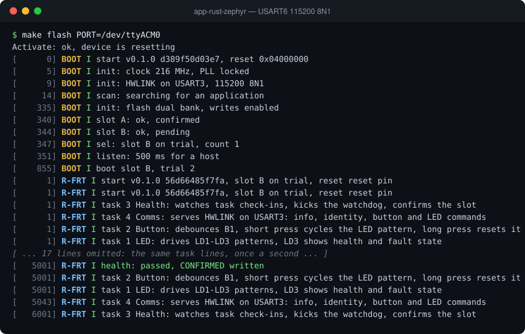

# app-rust-zephyr

The NUCLEO-F767ZI demo application written in Rust on Zephyr RTOS, using Zephyr's official Rust module. It runs under the A/B bootloader from either slot and does exactly the same job as the C FreeRTOS demo: LED patterns, the user button, HWLINK communication with the desktop GUI, watchdog supervision and self-confirmation after a health check. All application logic is Rust; a thin C layer covers the drivers the Rust bindings do not reach yet. It completes the C/Rust by FreeRTOS/Zephyr comparison set.

## Debug terminal

The debug log from a reset on a NUCLEO-F767ZI (USART6, 115200 8N1), recorded from the board. [Watch it replay line by line](https://soccentric-stm32.github.io/#rust-zephyr) on the project page.



<details>
<summary>Plain text</summary>

```console
$ make flash PORT=/dev/ttyACM0
Activate: ok, device is resetting
[      0] BOOT I start v0.1.0 d389f50d03e7, reset 0x04000000
[      5] BOOT I init: clock 216 MHz, PLL locked
[      9] BOOT I init: HWLINK on USART3, 115200 8N1
[     14] BOOT I scan: searching for an application
[    335] BOOT I init: flash dual bank, writes enabled
[    340] BOOT I slot A: ok, confirmed
[    344] BOOT I slot B: ok, pending
[    347] BOOT I sel: slot B on trial, count 1
[    351] BOOT I listen: 500 ms for a host
[    855] BOOT I boot slot B, trial 2
[      1] R-FRT I start v0.1.0 56d66485f7fa, slot B on trial, reset reset pin
[      1] R-FRT I start v0.1.0 56d66485f7fa, slot B on trial, reset reset pin
[      1] R-FRT I task 3 Health: watches task check-ins, kicks the watchdog, confirms the slot
[      1] R-FRT I task 4 Comms: serves HWLINK on USART3: info, identity, button and LED commands
[      1] R-FRT I task 2 Button: debounces B1, short press cycles the LED pattern, long press resets it
[      1] R-FRT I task 1 LED: drives LD1-LD3 patterns, LD3 shows health and fault state
[ ... 17 lines omitted: the same task lines, once a second ... ]
[   5001] R-FRT I health: passed, CONFIRMED written
[   5001] R-FRT I task 2 Button: debounces B1, short press cycles the LED pattern, long press resets it
[   5001] R-FRT I task 1 LED: drives LD1-LD3 patterns, LD3 shows health and fault state
[   5043] R-FRT I task 4 Comms: serves HWLINK on USART3: info, identity, button and LED commands
[   6001] R-FRT I task 3 Health: watches task check-ins, kicks the watchdog, confirms the slot
```

</details>

## Features

- Application logic in Rust (`no_std`, no allocator) on Zephyr's Rust module
- Thin C glue for USART3, watchdog, reboot, flash partition and fatal handler
- Runs from either bootloader slot, linked at `0x0800C000`
- Four Zephyr threads defined with `#[zephyr::thread]`
- Seven LED patterns on LD1/LD2 with LD3 reserved for errors
- B1 button with GPIO interrupt, 30 ms debounce and short/long press actions
- HWLINK over USART3 with interrupt-driven RX and TX
- SetBaud to 921600 with automatic fallback to 115200
- HWLINK codec shared with the Rust Embassy demo
- Health thread is the only watchdog feeder with 500 ms check-ins
- CONFIRMED record written after the trial health check
- Fail-health Kconfig option exported to Rust as a `cfg` flag
- CPU faults, stack overflows and Rust panics captured into no-init RAM
- rustfmt and clippy checks with warnings as errors
- About 45 KB flash and 35 KB RAM, within a 128 KB / 64 KB budget
- Produces a ready-to-flash bootloader image (`rust-zephyr-app.img`)
- Reproducible Docker build environment

## Project layout

```
src/                Rust application crate (`no_std`, no allocator)
  app/              Zephyr threads (health, comms, button, LED), IPC and services
  platform/         Rust FFI surface, board/boot constants, build metadata
  protocol/         HWLINK COBS/CRC-32 framing and fixed-buffer FlatBuffers codec
platform/           C platform layer for the driver APIs the Rust bindings miss
  platform.c        USART3, watchdog, reboot, flash partition, fatal handler
  platform.h        Declarations shared with `src/platform/plat.rs`
  debug_log.c       USART6 debug log backend
boards/             nucleo_f767zi.overlay and the devicetree augments
protocol/           Shared HWLINK FlatBuffers schema
scripts/            build, lint, Docker, image and footprint helpers
docker/             stm32-dev-rust-zephyr image on top of the shared stm32-dev base
ci/                 Jenkins release packaging and version helpers
```

## Build and run

```bash
scripts/docker-dev.sh build   # build the stm32-dev-rust-zephyr container image once
scripts/build.sh              # build inside the container
make flash                    # upload build/rust-zephyr-app.img through the bootloader
make help                     # list all targets
```

## Related projects

- [bootloader](https://github.com/soccentric-stm32/bootloader) — A/B bootloader with UART update, CRC32 checks, trial boot and rollback
- [app-c-freertos](https://github.com/soccentric-stm32/app-c-freertos) — Demo application in C on FreeRTOS
- [app-c-zephyr](https://github.com/soccentric-stm32/app-c-zephyr) — Demo application in C on Zephyr RTOS
- [app-rust-freertos](https://github.com/soccentric-stm32/app-rust-freertos) — Demo application in Rust on Embassy
- [validation-firmware](https://github.com/soccentric-stm32/validation-firmware) — HWVAL hardware validation firmware
- [validation-gui](https://github.com/soccentric-stm32/validation-gui) — HWVAL Studio: desktop GUI for tests, updates and flashing
- [factory-station](https://github.com/soccentric-stm32/factory-station) — HWVAL Factory: end-of-line test and provisioning station
- [soccentric-stm32.github.io](https://github.com/soccentric-stm32/soccentric-stm32.github.io) — Project website

## License

Released under the [MIT License](LICENSE) © 2026 Sandesh Ghimire. You are free
to use, modify and ship it in your own products.

Contributions are welcome. Fork the repository, make your change on a branch and
open a pull request. Bug reports, ideas and improvements are all appreciated.
